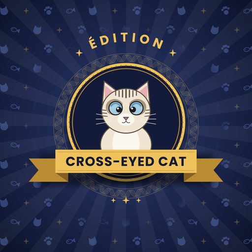

<p align="right"></p>

# MUSICAL MAYHEM · V5

*Une édition **Cross-Eyed Cat** : jeux open source.*

**THE ULTIMATE TEAM MUSIC GAME** : un show musical à épisodes, pas un simple blind test.
Un catalogue d'épreuves modulaires, une vraie mise en scène de sélection ("qui choisit la
prochaine épreuve ?"), des pouvoirs, des mises, jouable sur téléphones + une TV, contrôlé
depuis l'ordinateur de l'animateur.

```
                🎛️ HOST (PC animateur)
                        │
                serveur temps réel (Node.js + WebSocket)
                        │
        ┌───────────────┼───────────────┐
        │               │               │
   📺 SCREEN (TV)   📱 TEAM ×N     📱 TEAM ×N
```

Le serveur est l'autorité absolue : les scores, le buzzer, la sélection d'épreuve, les
pouvoirs et les mises sont toujours calculés côté serveur. Les téléphones ne sont que des
télécommandes.

---

## 1. Installation

Node.js 18+ requis.

```bash
npm install
npm start
```

Le terminal affiche :

```
================================================
 MUSICAL MAYHEM V5
 HOST KEY : 7A3F2C   (entrez cette clé dans host.html)
================================================
MUSICAL MAYHEM V5 → http://localhost:8080
Sur le même Wi-Fi, les joueurs utilisent : http://192.168.1.20:8080
```

**Notez la HOST KEY** : c'est le code qui protège le cockpit animateur. Par défaut elle change
à chaque redémarrage du serveur (ce qui déconnecte un navigateur qui l'avait déjà enregistrée).

**Pour la verrouiller en fixe** (recommandé si vous redémarrez le serveur plusieurs fois avant
la soirée), deux façons, la première étant prioritaire si les deux sont présentes :

```bash
# 1) variable d'environnement, pour un lancement ponctuel
HOST_KEY=PARTY2026 npm start

# 2) ou une fois pour toutes : copiez data/host-key.example.json en data/host-key.json
{ "key": "PARTY2026" }
```

Le terminal affiche `[fixe]` à côté de la clé quand elle est verrouillée, `[aléatoire]` sinon.
`data/host-key.json` n'existe pas par défaut (il est dans `.gitignore`) : il reste local à
votre machine, ne le partagez pas.

Pour que les téléphones des joueurs se connectent, ordinateur et téléphones doivent être sur
le **même réseau Wi-Fi**. Le serveur détecte automatiquement l'IP locale de la machine (affichée
dans le terminal au démarrage, ex. `http://192.168.1.20:8080`) et l'utilise aussi bien pour
cette ligne que pour le QR code affiché sur `screen.html` : les joueurs peuvent scanner ce QR
même si `screen.html` est lui-même ouvert via `localhost` (nécessaire pour Spotify, voir §7).
Si la machine a plusieurs interfaces réseau (VPN, machine virtuelle...) et que la détection se
trompe, fixez l'IP à utiliser avec `LAN_IP=192.168.1.20 npm start`.

## 2. Le soir de la fête

1. Sur l'ordinateur branché à la TV : ouvrez `http://<IP>:8080/screen.html` en plein écran.
   Le QR code et le code à 4 chiffres apparaissent.
2. Sur l'ordinateur de l'animateur (peut être le même) : ouvrez `http://<IP>:8080/host.html`,
   entrez la HOST KEY.
3. Les joueurs scannent le QR code (ou vont sur `/team.html` et tapent le code), puis
   choisissent leur équipe en un tap. Plusieurs téléphones peuvent rejoindre la même équipe.
   Le premier arrivé peut **personnaliser le nom et la couleur** de son équipe (palette de
   12 couleurs, sans doublon entre équipes) via l'écran qui apparaît juste après ; les
   suivants rejoignent directement l'équipe déjà nommée. Modifiable à tout moment via le
   ✏️ à côté du nom d'équipe, et l'animateur peut aussi forcer un renommage depuis le cockpit.
4. Depuis le cockpit Host (écran de **Configuration**) : cochez les épreuves disponibles ce
   soir, choisissez qui décide de la prochaine épreuve, réglez le nombre d'épreuves visé, puis
   cliquez **🚀 DÉMARRER LA SÉLECTION**.
5. L'équipe désignée choisit une épreuve sur son téléphone parmi 3 proposées (animation "a le
   pouvoir de choisir" sur l'écran public). L'épreuve démarre, l'animateur pilote buzzer /
   réponses / minuteur / mises selon le type d'épreuve.
6. À la fin de chaque épreuve : **SÉLECTION SUIVANTE** relance le cycle. Le nombre d'épreuves
   et la durée cible s'affichent en permanence dans le cockpit.
7. La dernière épreuve est toujours celle configurée comme *finale* (mises par défaut) ; à sa
   fin, **TERMINER LA PARTIE** affiche l'écran champion.

`index.html` sert de hub de test local (liens directs vers host/team/screen).

## 3. Le catalogue d'épreuves

11 épreuves définies dans `data/challenges.json`, dont 4 héritées de la V4 (marquées
`legacy`) et 7 nouvelles pensées pour Spotify. Chacune déclare son mode de réponse, son
scoring, sa durée estimée, si elle utilise le buzzer/Spotify/les pouvoirs. **`the_chain` est
documentée mais non jouable** (mécanique multi-étapes trop complexe pour être fiable en v1,
voir §9 pour l'ajouter proprement plus tard).

| Épreuve | Mode | Résumé |
|---|---|---|
| LE CLASSIQUE *(legacy)* | buzzer_compound | Titre + artiste, +1/+1 |
| TRADUCTION FOIREUSE *(legacy)* | buzzer | Titre traduit affiché à l'écran |
| CONTRE LA MONTRE *(legacy)* | panic | Chrono, réponses libres, contestation |
| LE PARI FINAL *(legacy, finale par défaut)* | bet | Année + style affichés, mise secrète, puis 30s pour deviner le titre en musique |
| 5 SECONDES CHRONO | buzzer_tiered | Points dégressifs selon le palier d'écoute |
| REPRISE OU ORIGINAL ? | buzzer_compound | Artiste original + interprète de la reprise |
| JOUEUR A, JOUEUR B OU LES DEUX ? | choice (3) | Deviner qui, du joueur A ou du joueur B (ou les deux), écoute vraiment le morceau joué. Renommez l'épreuve et ses options avec les prénoms de deux joueurs, et adaptez les bonnes réponses à leurs écoutes |
| DÉTECTIVE D'ALBUM | buzzer_compound | Album + année |
| FILM OU SÉRIE ? | buzzer | Thème musical de film/série joué, retrouvez son nom (affiche + nom à la révélation, 10 tirés au hasard parmi 76) |

**Mode secours**, toujours disponible : **⏭ SKIP CHALLENGE** (passe l'épreuve en cours),
**RÉVÉLER / PASSER**, **+/- manuels**, **FORCER LA RÉVÉLATION** (mises), **UNDO** (annule la
dernière action de l'animateur), et sur l'écran de sélection, cliquer directement une carte
force le choix si le téléphone de l'équipe ne répond pas.

## 4. Qui choisit la prochaine épreuve ?

Réglable dans l'écran de Configuration (`data/config.json` → `selection` pour les valeurs par
défaut) :

- **🏆 Le gagnant du défi** : l'équipe ayant le plus progressé pendant l'épreuve qui vient de
  se terminer choisit.
- **🔄 Le dernier au classement** : mécanique de comeback.
- **🎲 Roulette** : une équipe connectée est tirée au sort.
- **⚔️ Duel** : les deux meilleures équipes choisissent chacune une épreuve parmi 3 ; l'animateur
  tranche entre les deux propositions.
- **🌀 Chaos** : le système choisit directement, sans vote (l'animateur clique CONTINUER).

Garde-fous anti-domination : `maxConsecutiveSelections` (une équipe ne choisit pas deux fois
de suite), `allowRepeat` (autoriser ou non de rejouer une épreuve déjà passée),
`comebackEnabled` (garantit au dernier de la partie un tour de choix au moins tous les 3
défis, quelle que soit la politique active). La dernière épreuve de la partie est toujours
celle définie comme `finalChallengeId` (LE PARI FINAL par défaut), forcée automatiquement sans
vote.

## 5. Cartes MAYHEM (pouvoirs)

6 types de pouvoir, habillés en cartes de Tarot (une lame majeure par pouvoir, choisie pour
coller au sens propre de la carte : `LA TOUR` pour BOMB, `LE PENDU` pour SILENCE, `LE FOU`
pour CHAOS...), définis via `MM.tarotCardHtml` (`public/js/client.js`) et réutilisés partout
où une carte s'affiche (main d'une équipe, révélation de fin de manche). Une seule carte est
distribuée **automatiquement par manche**, à la fin de celle-ci, à l'équipe qui a le plus
progressé en score pendant l'épreuve qui vient de se terminer (égalité : tirée au sort parmi
les équipes à égalité) ; le panneau Host (`DONNER`) reste disponible pour en distribuer
manuellement à tout moment :

`DOUBLE` `SHIELD` `ORACLE` `SILENCE` `BOMB` `CHAOS`

- Les cartes sont **privées** : un joueur ne voit que les cartes de sa propre équipe.
- Chaque épreuve déclare `allowedPowers` (quels pouvoirs peuvent être *utilisés* pendant
  elle) et `allowsPowers` (si cette épreuve distribue une carte à sa fin ou non : les mises
  et CONTRE LA MONTRE n'en distribuent pas). La carte remportée vient toujours du
  catalogue complet, pas des `allowedPowers` de l'épreuve qui vient de se terminer : elle
  sert pour une épreuve future.
- `SILENCE`/`BOMB` demandent de choisir une équipe cible (menu qui apparaît au tap).
  `SILENCE` ne dure que la question en cours : elle est levée automatiquement dès la
  question suivante.
- `SHIELD` annule automatiquement le prochain `SILENCE`/`BOMB` reçu ; `DOUBLE` double la
  prochaine fois que l'équipe marque des points : les deux restent actifs d'une question (et
  d'une épreuve) à l'autre jusqu'à ce qu'ils servent.
- `ORACLE` est refusée (sans consommer la carte) si la question en cours n'a pas d'indice
  renseigné dans `data/challenge-content.json` (`hint`) : la carte reste en main pour une
  question qui en a un, plutôt que d'être perdue pour rien.
- `CHAOS` tire un effet aléatoire dans `data/config.json` (`chaos`) et l'affiche à tout le
  monde ; c'est une contrainte à respecter sur parole (comme la contestation de CONTRE LA
  MONTRE), le serveur ne la fait pas respecter automatiquement.
- L'écran public montre l'effet, jamais qui a joué la carte — mais affiche bien, à la fin de
  chaque manche, qui a *remporté* la carte MAYHEM de la manche (équipe + carte expliquée),
  suivi d'un récap du score de chaque équipe.

## 6. Contenu secret par équipe (mécanique disponible, pas utilisée actuellement)

Le moteur sait distribuer une **information privée par équipe**, jamais visible du public ni
des autres équipes (bannière rouge sur le téléphone concerné, et pour l'animateur seul côté
Host) : `hasPrivatePayload`/`privatePayloadKind` sur une épreuve (`data/challenges.json`) plus
le contenu associé (`data/challenge-content.json`) déclenchent ça automatiquement. Deux formes
existent dans le moteur, toutes deux actuellement sans épreuve qui les utilise (gardées comme
base pour une future épreuve, voir §9) :
- `banned_words` : les mêmes mots bannis pour toutes les équipes (ex : faire deviner un titre
  sans dire le titre/l'artiste/des mots clés) ; bouton 🚫 côté Host si violation, pénalité
  réglable (`violationPenalty`).
- `forbidden_word` : un mot différent tiré au sort par équipe depuis un pool commun
  (`wordPool`).

## 7. Audio et Spotify

Aucune dépendance obligatoire : le jeu ne casse jamais si rien n'est branché.

- **Lecture manuelle (repli, toujours fiable)** : placez vos extraits dans `media/` avec le nom
  exact de `audio_ref` + `.mp3` (ex : `media/CLASSIC_01.mp3`), ou utilisez Spotify/YouTube
  séparément sur le poste animateur. Le panneau Host (`▶` / `⏸` / `⏪ 3s` / `⏮`) pilote alors un
  lecteur audio local par piste dans le navigateur de l'animateur. Un fichier manquant échoue
  silencieusement (404), sans jamais bloquer le jeu.
- **Lecture Spotify automatisée (recommandée, sans fichier local)** : une fois connecté, les
  134 morceaux de `data/tracks.json` (chacun avec un vrai `spotifyUri` vérifié via l'API
  Spotify) se jouent directement, avec le son sortant du poste qui affiche `screen.html`. Le
  panneau Host garde les mêmes boutons `▶`/`⏸`/`⏪ 3s`/`⏮`, juste branchés sur Spotify au lieu
  d'un fichier local. Mise en route (une fois) :
  1. Créez une app sur [developer.spotify.com/dashboard](https://developer.spotify.com/dashboard)
     (gratuit), copiez `data/spotify.example.json` en `data/spotify.json` (ignoré par git) et renseignez-y son
     `clientId`/`clientSecret` (ou les
     variables d'environnement `SPOTIFY_CLIENT_ID`/`SPOTIFY_CLIENT_SECRET`), puis dans les
     réglages de l'app ajoutez exactement `http://127.0.0.1:8080/auth/spotify/callback` comme
     Redirect URI (Spotify exige `127.0.0.1`, pas `localhost`, et une correspondance exacte,
     adaptez le port si vous en utilisez un autre).
  2. Ouvrez `screen.html` sur l'appareil qui doit sortir le son (TV, PC branché aux enceintes)
     **avec l'URL `http://localhost:8080/screen.html`**, donc directement sur la machine qui
     exécute `node server.js` (ex : le PC branché à la TV/aux enceintes fait aussi tourner le
     serveur). Le Web Playback SDK de Spotify exige un « contexte sécurisé » (`https://` ou
     `localhost`/`127.0.0.1`) et refusera de s'initialiser (erreur `initialization_error` dans
     la console) si `screen.html` est ouvert via l'IP Wi-Fi (`http://192.168.x.x:8080/...`)
     depuis un autre appareil. Si votre écran doit être sur un autre appareil que le serveur,
     restez en lecture manuelle (§ ci-dessus), c'est pour ça qu'elle reste le repli par défaut.
  3. Dans `host.html`, cliquez **Connecter Spotify** et validez l'écran de consentement
     Spotify avec un compte **Premium** (requis par l'API de lecture, un compte gratuit
     recevra une erreur `account_error` et le jeu restera en lecture manuelle). Faites cette
     étape depuis le navigateur de la machine qui exécute `node server.js` elle-même (donc via
     `http://localhost:8080/host.html`) : la redirection OAuth revient sur `127.0.0.1`, qui ne
     désigne le bon serveur que si c'est la même machine. Une fois connecté, le reste (jouer
     depuis un autre appareil sur le Wi-Fi, cf. §2) fonctionne normalement.
  4. Le panneau Host affiche `✅ connecté` puis `Écran : 🟢 prêt` dès que `screen.html` a
     enregistré son lecteur : les boutons de lecture pilotent alors vraiment Spotify.
  - Techniquement : `lib/spotifyAuth.js` fait l'Authorization Code OAuth (le secret reste
    côté serveur, pas de PKCE nécessaire), le token est stocké dans `data/spotify-token.json`
    (jamais commité) et rafraîchi automatiquement. `screen.html` charge le Web Playback SDK de
    Spotify et s'enregistre comme appareil Spotify Connect nommé « Musical Mayhem · Écran » ;
    `lib/musicSource.js` bascule alors de `ManualMusicSource` vers `SpotifyMusicSource`.
  - Le token de lecture servi à `screen.html` (`/api/spotify/playback-token`) n'est pas protégé
    par la clé animateur, comme le reste des rôles Team/Screen dans ce jeu (soirée entre amis
    sur le même Wi-Fi, pas une appli multi-tenant), gardez ça en tête si votre réseau n'est
    pas de confiance.
- **Recherche Spotify + ajout direct de questions** : le même outil dans le cockpit Host cherche
  un morceau et, sous les résultats, un panneau **➕ AJOUTER UNE QUESTION** l'ajoute directement
  à l'épreuve de votre choix (`data/tracks.json` + `data/challenge-content.json` sont réécrits
  immédiatement, sans redémarrer le serveur). Le formulaire s'adapte au format exact de
  l'épreuve choisie (1 piste, options de choix, mots interdits...), donc vous n'avez besoin
  d'éditer les JSON à la main que pour `the_chain` (non implémentée). Le bouton **📋 Copier**
  reste disponible pour qui préfère éditer les fichiers directement.
- Aucun fichier audio ni parole n'est fourni dans ce dépôt.

## 8. Contenu (data/)

Trois fichiers séparent le catalogue, la musique et les questions :

- **`data/challenges.json`** : le catalogue des épreuves (voir §3). C'est ici qu'on règle la
  durée estimée, le scoring, les pouvoirs autorisés, etc.
- **`data/tracks.json`** : la base de morceaux partagée : `{id, spotifyUri, audioRef, title,
  artist, year, album, tags[]}`. Une même piste peut être référencée par plusieurs questions.
- **`data/challenge-content.json`** : les questions de chaque épreuve, qui référencent des
  pistes de `tracks.json` par `trackId`/`trackIds`. Formes principales :

```jsonc
// buzzer / buzzer_tiered simple (lost_in_translation, five_seconds...)
{ "id": "CL01", "challenge": "classic_blind_test", "number": 1, "trackId": "trk_019", "hint": "" }

// buzzer_compound à une piste (classic_blind_test, album_detective)
// pas de champ "answers" : l'animateur juge en regardant le titre/artiste/album/année
// de la piste elle-même, déjà affichés dans le panneau Host.
{ "id": "AD01", "challenge": "album_detective", "number": 1, "trackId": "trk_130", "hint": "" }

// buzzer_compound avec info hors-piste (cover_original : la piste jouée EST la reprise)
{ "id": "CO01", "challenge": "cover_original", "number": 1, "trackId": "trk_063", "extra": { "original": "" }, "hint": "" }

// panic (beat_the_clock)
{ "id": "BTC01", "challenge": "beat_the_clock", "number": 1, "theme": "", "durationSeconds": 30 }

// perform avec secret par équipe (banned_words, voir §6) : mécanique disponible pour une
// future épreuve, aucune épreuve actuelle ne l'utilise
{ "id": "DST01", "challenge": "ma_nouvelle_epreuve", "number": 1, "trackId": "trk_118", "bannedWords": ["", "", ""] }
```

Remplissez `title`/`artist`/`spotifyUri`/`audioRef`/`year`/`album` dans `data/tracks.json`, et
les champs spécifiques (`options[].label`, `criterion`, `theme`, `action`, `bannedWords`,
`wordPool`, `extra.original`...) dans `data/challenge-content.json`, c'est la seule chose à
éditer pour préparer votre soirée. `npm run gen-challenge-content` régénère un squelette vide
(mêmes IDs, mêmes tailles) si besoin. Aucun lien Spotify n'est pré-rempli.

`data/config.json` contient les noms/couleurs/emojis d'équipes par défaut, la palette de
personnalisation, le catalogue de pouvoirs, les effets CHAOS, et les valeurs par défaut de
`game`/`selection` : tout est éditable sans toucher au code.

### Ajouter une nouvelle épreuve

1. Choisissez le mode qui correspond à sa mécanique (voir le tableau du §3, la plupart des
   idées neuves rentrent dans `buzzer`, `buzzer_compound`, `buzzer_tiered`, `choice` ou
   `perform` sans écrire de code nouveau).
2. Ajoutez une entrée dans `data/challenges.json` (copiez une épreuve existante du même mode).
3. Ajoutez son contenu dans `data/challenge-content.json` (même forme que les exemples ci-dessus).
4. C'est tout, elle apparaît automatiquement dans l'écran de Configuration du Host.

Pour une mécanique vraiment inédite (comme `the_chain`, qui a besoin d'un état multi-étapes et
de propositions d'équipe en cours de partie), il faut étendre `lib/actions.js` : un nouveau
`mode`, un handler dans `HOST_ACTIONS`/`handlers`, et sa projection dans `lib/views.js`.

## 9. Robustesse

- **État persistant** : la partie entière (scores, équipes, sélection, historique) est
  sauvegardée dans `data/save.json` après chaque action, et restaurée automatiquement si le
  serveur redémarre. Une sauvegarde d'une version antérieure au moteur d'épreuves est ignorée
  proprement (repart en lobby) plutôt que de planter.
- **Reconnexion** : chaque téléphone a un identifiant de session stocké en `localStorage`. Un
  rechargement de page (crash navigateur, Wi-Fi coupé) retrouve automatiquement son équipe,
  son score et ses pouvoirs.
- **UNDO** : le cockpit Host garde un historique (jusqu'à 25 actions) pour annuler sa dernière
  action. Comme dans la V4, seules les actions de l'animateur sont annulables (pas le choix
  d'une équipe), pour un choix d'épreuve indésirable, **⏭ SKIP CHALLENGE** est le bon outil.
- **Export** : boutons/URLs `/api/export.csv` et `/api/export.json` pour sauvegarder le score
  final.
- **RESET** : repart d'une partie neuve (nouveau code de connexion) sans redémarrer le serveur.

## 10. Mode démo

Dans le cockpit Host, le bouton **🧪 DEMO** réinitialise la partie et joue automatiquement une
partie complète (5 équipes simulées, sélection dynamique, plusieurs modes d'épreuve, pouvoirs,
chrono, mises) en ~90 secondes, utile pour tester seul, sans téléphones, que tout
l'enchaînement fonctionne.

## 11. Architecture

```
server.js                HTTP + WebSocket, fichiers statiques, QR code, recherche Spotify, export CSV/JSON
lib/store.js               état de partie (source de vérité), sauvegarde/restauration disque
lib/challenges.js            charge le catalogue + tracks.json + challenge-content.json,
                              résout les pistes (y compris le tirage aléatoire par tag de
                              spotify_roulette)
lib/selection.js              les politiques de sélection (winner/last/roulette/duel/chaos) et
                               les garde-fous anti-domination
lib/musicSource.js              abstraction de lecture : ManualMusicSource (repli) et
                                 SpotifyMusicSource (Connect REST API), voir §7
lib/spotifyAuth.js              connexion Spotify utilisateur (Authorization Code OAuth),
                                 stockage/rafraîchissement du token, utilisée uniquement par
                                 SpotifyMusicSource, jamais par le moteur de jeu directement
lib/actions.js               toutes les règles du jeu : cycle épreuve/sélection, scoring par
                              mode (buzzer/buzzer_compound/buzzer_tiered/choice/panic/bet/perform),
                              pouvoirs, contenu privé par équipe, lecture musicale, undo
lib/views.js                projection de l'état par rôle (host voit tout, team/screen voient
                             une version filtrée : pas de réponses, pas de mises adverses, pas
                             de contenu privé d'une autre équipe, pas de choix avant révélation)
lib/demo.js                   partie de démonstration automatique
lib/spotify.js                  recherche Spotify (Client Credentials), outil de préparation,
                                 isolé du moteur de jeu
data/config.json          équipes, pouvoirs, effets chaos, palette, réglages par défaut de jeu/sélection
data/challenges.json        catalogue des épreuves
data/tracks.json              base de morceaux partagée (134 morceaux réels, spotifyUri vérifiés)
data/challenge-content.json     questions de chaque épreuve
data/spotify.json                 identifiants Spotify (clientId/clientSecret d'une app créée sur le
                                   dashboard développeur), à créer depuis spotify.example.json, jamais commité
data/spotify-token.json           token OAuth utilisateur Spotify (créé après connexion, jamais commité)
data/host-key.json                  clé animateur fixe optionnelle, à créer depuis host-key.example.json
                                     (absente par défaut → aléatoire), jamais commitée
data/save.json                      sauvegarde automatique de la partie en cours, jamais commitée
public/                    host.html / team.html / screen.html / index.html + css/js partagés,
                            img/ (logo de l'édition Cross-Eyed Cat)
media/                      (vide) : placez ici vos extraits audio nommés d'après audioRef
```

Protocole réseau minimal : le client envoie des actions typées (`join`, `buzz`,
`pickChallenge`, `submitChoice`, `usePower`, `host:markAnswer`, …), le serveur valide tout
côté serveur puis rediffuse à chaque client une vue `{type:'state', state}` déjà filtrée pour
son rôle. Un seul type de message serveur, un seul point de rendu par page.

## 12. Tests

```bash
npm run challenge-engine-test  # sélection (5 politiques), scoring par mode, isolation du
                                # contenu privé, skip/force-pick, undo : nécessite le serveur démarré
npm run smoke-test              # buzzer, scoring, pouvoirs, panic, mises, reconnexion
npm run profile-test            # personnalisation nom/couleur d'équipe
npm run spotify-test            # lib/spotify.js (parsing, cache de token, erreurs) sans vraies clés
```

`scripts/gen-challenge-content.js` régénère `data/tracks.json` et
`data/challenge-content.json` vierges si besoin.

---

## Licence

[MIT](LICENSE)
